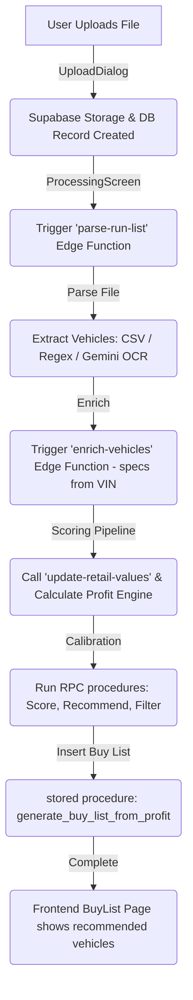

# How a Run List Becomes a Buy List: The Complete Flow

This document explains in simple terms how a user's uploaded auction run list (CSV, Excel, or PDF) goes from a raw file on their computer to a scored and filtered **Buy List** displayed on the screen.

---

## High-Level Flowchart

Here is the visual journey of how the data flows:



---

## Phase 1: Uploading the File

### 1. What happens in the UI?
When a dealer clicks the **"Upload Run List"** button, the [UploadRunListDialog.tsx](file:///d:/logiclot-st/logiclot-main/src/components/dashboard/UploadRunListDialog.tsx) dialog appears. 
The dealer drags and drops or selects a `.csv`, `.xlsx`, `.xls`, or `.pdf` file.

### 2. The Code Logic
When they click **"Create Buy List"**, the `handleSubmit` function does two things:
1. **Uploads the actual file** to Supabase Storage inside the `run-lists` bucket:
   ```typescript
   const uploadResult = await supabase.storage
     .from('run-lists')
     .upload(storagePath, file, { contentType: getRunListContentType(file) });
   ```
2. **Inserts a status row** into the `auction_run_lists` database table with the status set to `'uploaded'`:
   ```typescript
   const insertPayload = {
     organization_id: organizationId,
     created_by: userId,
     file_name: form.file_name.trim(),
     file_path: storagePath,
     status: 'uploaded', // Tells the app the upload succeeded
   };
   const dbResult = await supabase.from('auction_run_lists').insert(insertPayload);
   ```

---

## Phase 2: Parsing the File (Extracting Vehicles)

Once uploaded, the dialog closes, and the [ProcessingScreen.tsx](file:///d:/logiclot-st/logiclot-main/src/components/dashboard/ProcessingScreen.tsx) is loaded. This screen is responsible for triggering the parsing.

### 1. Triggering Deno Edge Functions
The frontend invokes the Supabase Edge Function [parse-run-list](file:///d:/logiclot-st/logiclot-main/supabase/functions/parse-run-list/index.ts):
```typescript
supabase.functions.invoke('parse-run-list', {
  body: { run_list_id: runListId },
});
```

### 2. How the Edge Function Reads the File
Inside the [parse-run-list](file:///d:/logiclot-st/logiclot-main/supabase/functions/parse-run-list/index.ts) code:
1. **CSV & Excel files**: The parser maps headers heuristically (e.g., matching "VIN", "Miles", "CR" columns using a map list) and parses rows using spreadsheet libraries.
2. **Text-based PDFs**: The code extracts text and applies regex patterns to identify vehicles based on common auction formats (Manheim, ADESA, CarMax, IAA).
3. **Scanned / Image PDFs**:
   - If text extraction yields no readable text, the database status updates to `'queued_for_ocr'`.
   - The frontend [ProcessingScreen.tsx](file:///d:/logiclot-st/logiclot-main/src/components/dashboard/ProcessingScreen.tsx) loops page-by-page calling the edge function in `ocr_page` mode.
   - For each page, the file is sent to the **Gemini 2.5 Flash API** using a custom prompt instructing it to extract the vehicles and return them as a structured JSON array.
   ```typescript
   // Prompt template inside Deno edge function:
   const content = await callGemini(
     `You are reading page ${pageNum} of an auction run list PDF... Extract vehicles: lane, run_order, lot_number, year, make, model, trim, mileage, cr_score, mmr_value, vin...`,
     base64
   );
   ```

### 3. Saving to the Database
Once the vehicles are parsed into JSON objects, they are cleaned (deduplicated) and inserted as rows into the `auction_vehicles` table under the corresponding `run_list_id`.

---

## Phase 3: Vehicle Enrichment (Getting Specifications)

Once the parsing is complete, the `ProcessingScreen` triggers the next edge function:
```typescript
await supabase.functions.invoke('enrich-vehicles', {
  body: { run_list_id: runListId },
});
```
This function:
1. Loops through the newly created `auction_vehicles`.
2. Takes their 17-digit **VIN** numbers.
3. Queries databases (like the National Highway Traffic Safety Administration - NHTSA API and CarQuery) to populate missing specification details such as vehicle trim, drive type, body type, and engine size.

---

## Phase 4: Scoring and Calculations (The "Profit Engine")

Now, the frontend runs the **Scoring Pipeline** [runListScoringPipeline.ts](file:///d:/logiclot-st/logiclot-main/src/lib/runListScoringPipeline.ts). This pipeline executes server-side PostgreSQL procedures (RPCs) to perform the financial calculations.

### Step 1: Getting Live Market Values
The pipeline invokes the Deno edge function `update-retail-values` to poll active vehicle sales platforms and fetch real-time retail comps based on the vehicles' details.

### Step 2: The Profit Engine Calculation
The PostgreSQL function `calculate_run_list_profit_engine` (defined in [20240607000001_fix_no_price_profit_engine.sql](file:///d:/logiclot-st/logiclot-main/supabase/migrations/20240607000001_fix_no_price_profit_engine.sql)) calculates crucial metrics:
1. **Estimated Reconditioning Cost (`estimated_recon_cost`)**:
   Calculated dynamically using a base cost ($400) adjusted by vehicle condition score (CR), mileage, age, brand complexity (e.g., luxury brands get penalized), and structural/mechanical risk flags:
   $$\text{Recon Cost} = \text{Base} + \text{CR penalty} + \text{Mileage penalty} + \text{Age penalty} + \text{Brand penalty} + \text{Risk penalty}$$
2. **Estimated Retail Value (`erv`)**:
   Adjusts the wholesale valuation by condition, mileage, and dealer margin:
   $$\text{ERV} = \text{Retail Anchor Value} + \text{CR Adjustment} + \text{Mileage Adjustment} + \text{Dealer Margin}$$
3. **Recommended Max Bid (`recommended_max_bid`)**:
   Helps dealers protect their profit margins:
   $$\text{Max Bid} = \text{ERV} - \text{Dealer Target Profit} - \text{Recon Cost} - \text{Auction Fee}$$
4. **Estimated Profit (`estimated_profit`)**:
   $$\text{Est. Profit} = \text{ERV} - \text{Acquisition Cost (MMR/Buy Now)} - \text{Recon Cost} - \text{Auction Fee}$$
5. **Base Profit Score**:
   Measures profit margin against the dealer's target profit. It returns a score from 25 to 100.

---

## Phase 5: Calibration & Recommendation Assignment

After financials are set, the database runs `finalize_run_list_scoring` (defined in [20260607060000_finalize_run_list_scoring.sql](file:///d:/logiclot-st/logiclot-main/supabase/migrations/20260607060000_finalize_run_list_scoring.sql)), which performs:
1. **`apply_vehicle_scoring`**: Adjusts the base `profit_score` using dealer preferences. For example:
   - **Adds 10 points** if the vehicle matches a preferred brand.
   - **Adds 5 points** if it matches a preferred model.
   - Adjusts scores based on the vehicle's market velocity (Average Days to Sell and Market Day Supply).
   - Generates positive reasons (e.g., "Clean Title", "CR meets minimum") and `risk_flags` (e.g., "High Mileage", "Frame Damage").
2. **`apply_recommendation_from_score`**: Assigns the final AI recommendation label to the vehicle:
   - **Strong Buy**: High profit score (85+), strong margin, and no major risk alerts.
   - **Buy**: Solid candidate (70+ score, $1500+ profit).
   - **Possible Buy**: Aligned but has higher risks or slightly lower margins.
   - **Pass**: Negative profit, mileage $> 200\text{k}$, or severe title brand risks.
   - **Review**: Missing price signals or unknown factors.
3. **`apply_hard_preference_filters`**: Evaluates vehicles against hard rules chosen by the dealer (such as maximum mileage, excluded brands, or excluding vehicles with salvage history). If a vehicle violates any of these, its recommendation is overridden to **'Pass'** and it's marked as excluded.

---

## Phase 6: Populating the Buy List Table

The final step in the pipeline is running the database procedure `generate_buy_list_from_profit`:
1. It reads the dealer's preferences or custom override preferences.
2. It selects vehicles from the `auction_vehicles` table that have an recommendation of **Strong Buy**, **Buy**, or **Possible Buy**.
3. It filters out any vehicles that violate the dealer's constraints (e.g., if a dealer doesn't buy Salvage titles, those are ignored).
4. It inserts up to **50 top-scoring vehicles** (sorted by profit score and estimated profit) into the `buy_list_items` table:
   ```sql
   INSERT INTO public.buy_list_items (buy_list_id, auction_vehicle_id, custom_max_bid, dealer_notes)
   SELECT bl.id, av.id, av.recommended_max_bid, 'Auto-selected by LogicLot'
   FROM public.auction_vehicles av
   WHERE av.ai_recommendation IN ('Strong Buy', 'Buy', 'Possible Buy')
     -- Matches all dealer brand, mileage, age, price, and condition filters...
   ORDER BY av.profit_score DESC NULLS LAST, av.estimated_profit DESC NULLS LAST
   LIMIT 50;
   ```
5. It logs the count of excluded vehicles in the `buy_list_generation_logs` table so dealers can see *why* certain vehicles were excluded.

---

## Phase 7: Displaying in the Buy List Page

When the pipeline completes, the `ProcessingScreen` updates the status of the run list to `'ready'` and redirects the dealer to the Buy List page:
```typescript
navigate(`/app/buy-list?run_list_id=${runListId}`);
```

Inside [BuyList.tsx](file:///d:/logiclot-st/logiclot-main/src/pages/app/BuyList.tsx):
1. The page loads all `auction_vehicles` for the selected run list.
2. It calculates metrics to show in summary cards (e.g., number of Strong Buys, total estimated profit).
3. It filters out severe title risks (Non-repairable / Certificate of Destruction) and displays the remaining list.
4. The dealer can switch between tabs (e.g., filtering only "Recommended" to view the top Buy List items) and add selected vehicles to a **Lane Strategy Map** for bidding.
